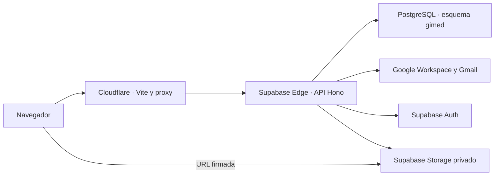
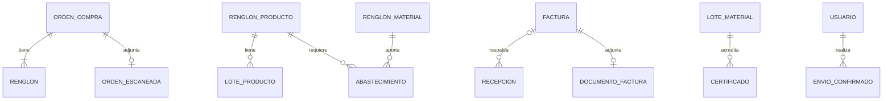

# Arquitectura y estándares

Las rutas de Hono invocan casos de uso. PostgreSQL posee los datos de negocio. Los adaptadores de Google y Storage se llaman después de autenticar la cuenta. El navegador conoce el origen del front y una cookie opaca. El Worker transmite los callbacks y reemplaza el encabezado privado del proxy. Las mutaciones validan el origen y el encabezado CSRF.

## Datos y módulos

| Área | Operaciones e invariantes | Comprobación |
|---|---|---|
| Catálogos | Proveedores, empaques, productos, costos, materiales y códigos. Preservar ceros de MAIA. Un único GS1 asignado por producto. | Pruebas de catálogo, costo, favoritos, códigos e importación. |
| Órdenes y seguimiento | R01–R02. OC y OCM tienen consecutivos separados. Material y otros comparten OCM. Renglones del mismo tipo con posiciones 1–7. La autorización inmoviliza proveedor y composición según las reglas del flujo. | Concurrencia e idempotencia de API y pruebas de hojas, lotes y autorización. |
| Facturas y abastecimiento | R03–R05. La factura se identifica por proveedor y número normalizado. Abastecimiento conserva las relaciones entre renglones y orígenes. | Pruebas de facturas, recepciones, pendientes y consolidación. |
| Documentos | R06–R07 y R10. Vigencia única por clase y propietario, más una plantilla global. Reemplazar publica el objeto verificado y retira el anterior. | Pruebas de carga, sustitución, acceso, limpieza y correo. |
| Correos y contactos | R08–R11. Sugerencias por contacto/evento, destinatarios explícitos, adjuntos vigentes e historial después de confirmación de Gmail. | MIME, revisión previa, resultado por mensaje y conciliación. |
| Materiales | R12–R13. Código MAIA obligatorio según el tipo y restricciones de corrugado, sticker y cinta. | Validación de catálogo y pruebas de renglones de producto. |

Usar SQL parametrizado con un rol de ejecución privado. Las claves internas nuevas son UUID. La numeración visible es texto canónico. El API mantiene importes decimales como texto. PostgreSQL usa `date` para días operativos y `timestamptz` para eventos. El adaptador normaliza las fechas operativas al día de Bogotá y las convierte al formato ISO de la interfaz.

`legacy/` conserva las reglas verificadas mientras se extraen las dependencias del estado global. Las escrituras pasan por una transacción con bloqueo de dominio, validan las diferencias y registran actor y colecciones. La revisión del contexto evita aplicar cambios parciales fuera de orden. Los listados públicos tienen su contrato de consulta. Las vistas heredadas que requieren el contexto amplio se deben medir antes de ampliar volumen.

Mantener los cambios aditivos. Un error de negocio debe tener código estable, mensaje legible y campos que el usuario pueda corregir. Usar pruebas de solicitudes HTTP y restricciones de Postgres para cambios concurrentes.
